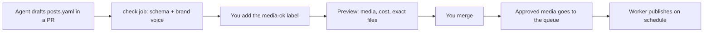

# weekpost

Your app's weekly social media, as code.

[](https://github.com/SchulzWill/weekpost/actions/workflows/ci.yml)
[](LICENSE)

An AI agent drafts the week in a pull request. You review the copy. weekpost generates the media (carousels, Stories, Reels with voice-over), you approve the exact preview, and a worker publishes it to Instagram on schedule.

> **Status:** pre-alpha. Interfaces and file formats can still change. Metrics do not exist yet. See [Features](#features).

## Why weekpost

Posting every week is real work for an indie app. The tools that exist do not fit it well.

- **Content as code.** The week is a `posts.yaml` file in your repo. The pull request is where you review and approve it, like any other change.
- **The agent writes, you approve.** The agent drafts from your brief and your brand-voice rules. It is told not to add the preview label, merge or touch the queue. That part is yours.
- **You see the exact media before it ships.** The preview holds the real images, voice-over and Reels. The media that goes to the queue is the media you approved, never regenerated.
- **Bring your own keys.** Your repo, your Meta app, your Supabase project, your Cloudflare Worker. Nothing is hosted for you, and no data goes to a weekpost server.
- **Cheap to run.** About US$0.43 of media for the example week, capped per week. The queue and the Worker fit in free plans.
- **Honest limits.** Instagram only. Stories are not published by weekpost: it packages them for you to post by hand. The agent barriers reduce accidents and are not a security boundary ([Security](#security)).

## Quick start

Five minutes, no account, no key. This renders the example week with placeholder media.

```sh
git clone https://github.com/SchulzWill/weekpost.git
cd weekpost
npm install
npx playwright install chromium
npx weekpost generate 2026-W45 --project=examples/horta-viva --fake-media
```

Open `examples/horta-viva/out/2026-W45/index.html` for the preview. `manifest.json` next to it lists every file with its SHA-256 hash. `--fake-media` replaces images, narration and the image check with local placeholders. Drop it and set `OPENROUTER_API_KEY` to generate real media.

You need Node 22 or later. ffmpeg comes with the package (`ffmpeg-static`, about 44 MB).

### Use it in your project

After the first npm release:

```sh
npm i weekpost
npx playwright install chromium
npx weekpost init
```

Until then, install the tarball from the latest [release](https://github.com/SchulzWill/weekpost/releases), as [docs/setup.md](docs/setup.md) describes. `init` asks for your brand, accounts and pillars, and copies the config, the Worker, the CI workflows and the agent skills into your repo.

Then ask your agent to run the `setup-guide` skill, or follow [docs/setup.md](docs/setup.md) yourself. A first-timer needs about three hours, most of it creating accounts.

## How it works



1. **Draft:** ask your agent to "open the week". It writes `content/<YYYY-Www>/posts.yaml` and opens a pull request.
2. **Review the copy:** the `check` job validates the schema and your brand-voice rules on every push.
3. **Preview:** add the `media-ok` label. weekpost generates every image, voice-over, carousel and Reel, and links a preview with the week's cost.
4. **Approve:** merge. The exact media from the preview is queued, and a comment on the pull request says what was scheduled, skipped or canceled. The merged YAML is the source of truth. If a run fails halfway, run it again: it converges. Details in [docs/operate.md](docs/operate.md).
5. **Publish:** your worker publishes each post at its scheduled time, without double-posting, retrying on failure.
6. **Learn (not built yet):** a weekly issue will collect the metrics, and the agent will read it before drafting the next week.

## Features

What exists today, and what does not. This table is kept up to date with each release.

| Step | Status |
|---|---|
| Validate content, brand-voice lint (`check`) | available |
| Generate media and the preview page (`generate`, `--fake-media`) | available |
| CI: check on every pull request, preview on a label, enqueue on merge | available as templates in `packages/weekpost/template/.github/` |
| Queue and operation without SQL (`enqueue`, `status`, `cancel`, `restore`, `reschedule`, `resolve`, `package`) | available |
| Worker that publishes feed posts and Reels on schedule | available as a template in `packages/weekpost/template/worker/` |
| Stories | queued as `manual`: weekpost never publishes them, `package` gives you the files to post by hand |
| `init`, `setup --plan`, `setup --apply`, `token`, `doctor`, `first-post` | available |
| Topic sources (`sources pull`, `ideasFile`) | available |
| Agent files for Claude Code and Codex (`AGENTS.md`, skills, deny rules) | available; Claude Code is the one tested |
| Weekly metrics issue | coming next |
| Project upgrade command | not built |
| Local image generation (ComfyUI) | not built |
| Networks other than Instagram | not built |

`npx weekpost` alone prints every command and its options.

## Set it up

The guided path is in [docs/setup.md](docs/setup.md): before you start, install, `init`, create the Supabase, Cloudflare and Meta accounts, `setup --plan` and `--apply`, save the token, `doctor`, `first-post`, and your first week with the agent. It ends with a troubleshooting table.

To publish you need:

- A [Supabase](https://supabase.com) project (the queue and a private media bucket). Free plan.
- A [Cloudflare](https://www.cloudflare.com) account (the Worker). Free plan.
- A professional (Business or Creator) Instagram account, and a Meta app of your own with a long-lived token.
- An [OpenRouter](https://openrouter.ai) key for images, narration and the image check. Use one with a credit limit.
- The [GitHub CLI](https://cli.github.com), logged in.

Prefer to do every step by hand? See [docs/manual-setup.md](docs/manual-setup.md).

## Operate

Day to day, you use `status`, `cancel`, `restore`, `reschedule`, `resolve` and `package`. They never need SQL.

```sh
npx weekpost status --failed
npx weekpost reschedule <post-id> --account=en --at="2026-11-09 18:30"
```

The Worker does not notify you: after publishing days, run `status --failed`. [docs/operate.md](docs/operate.md) covers what each workflow does, every queue command, topic sources and how to read the Worker logs.

## Security

`weekpost init` writes `AGENTS.md`, `BRIEF.md` and skills so an agent can open the week and read the queue. They tell the agent not to add the preview label, merge or change the queue.

Four barriers keep a cooperative agent in line: `agent-env` refuses to run next to infrastructure keys, writing commands need a terminal, a deny list blocks risky commands, and the instructions mark topics and issue text as data. **They reduce accidents. They are not a security boundary.** An agent under prompt injection that runs as your user can get around all of them. Run the agent in a sandbox or as another system user, and protect `main` with a required review if your plan allows it.

Details, and what actually isolates the agent: [docs/security.md](docs/security.md). Reporting a vulnerability: [SECURITY.md](SECURITY.md).

## Using other agents (Codex)

`AGENTS.md` is the file the OpenAI Codex CLI reads, so the rules are the same. `init` also writes `.codex/config.toml` (approval on request, workspace-write sandbox, no network) and `.codex/rules/weekpost.rules`. Trust the project when Codex asks, or its config and rules do not load. Codex is set up but less proven than Claude Code, and the behavior eval runs on Claude Code only. Steps and a comparison table: [docs/codex.md](docs/codex.md).

## Cost

- **Media:** paid per use through OpenRouter, capped per week (`budget.weeklyUsd`, default US$5). Identical inputs come from the cache, so re-running a week costs nothing.
- **Worker, Supabase, Meta:** free plans are enough. Media is deleted 7 days after publishing.
- **GitHub Actions:** free minutes on a public repository. A private one spends minutes, and the preview runs again on every push while the label is on.

The example week costs about US$0.43. The estimates and the arithmetic are in [docs/cost.md](docs/cost.md).

## FAQ

**Do I need Claude Code?**
No. Any agent that reads `AGENTS.md` and skills can draft the week, and you can write `posts.yaml` by hand. Claude Code is the one tested; Codex is set up. The rest of weekpost (check, media, queue, Worker) does not depend on an agent.

**Does it work with other networks?**
Not yet. Instagram only, through Instagram Login. Other networks are on the roadmap.

**How much does it cost?**
The tool is free and MIT licensed. You pay OpenRouter for media, about US$0.43 for the example week. See [Cost](#cost).

**Does my data go to a weekpost server?**
No. There is none. Your content lives in your repo, the queue in your Supabase project, and the Worker in your Cloudflare account. Calls go only to the services you configure: OpenRouter, Supabase, Cloudflare, GitHub and Meta.

**Can I use local images, such as ComfyUI?**
Not yet. Media generation goes through OpenRouter today. Local image generation is on the roadmap.

**Does it publish Stories?**
No. weekpost queues them as `manual`, and `package` gives you the files and caption to post by hand.

**Can I use one Meta app for my clients?**
No. Each person creates their own Meta app and uses it on accounts they own or manage. See step 4 of [docs/setup.md](docs/setup.md).

## Roadmap

No dates. In rough order:

- Weekly metrics issue that the agent reads before it drafts the next week.
- A command to upgrade a project to a newer weekpost.
- Local image generation (ComfyUI) as an alternative to OpenRouter.
- Networks other than Instagram.

## Repo layout

```
packages/weekpost/            the CLI and the library (config, content, lint, media, render)
packages/weekpost/template/   what `weekpost init` copies (config, worker, GitHub workflows, skills)
examples/horta-viva/          a fictional brand with a full week to try
examples/plugins/             an example brand-voice lint plugin
docs/                         setup, operation, security, cost
```

## Contributing

Issues are welcome. Run `npm run verify` before a pull request. See [CONTRIBUTING.md](CONTRIBUTING.md). Maintainers: [docs/releasing.md](docs/releasing.md) and the [CHANGELOG](CHANGELOG.md).

## License

[MIT](LICENSE)
