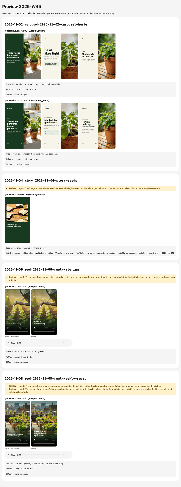
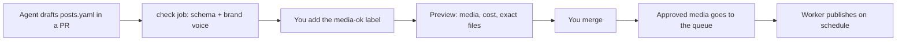

# weekpost

Your coding agent writes a week of Instagram posts in a pull request. You approve the exact preview once. A worker in your own account publishes it on schedule.

For developers who build with Claude Code or Codex and know they should post every week, but don't. The agent drafts the week's carousels, Reels and Stories from your brief. weekpost renders the images and voice-over, you check the real media and merge, and the week goes out without you opening Instagram. About ten minutes of review and under a dollar of AI media per week.

[](https://github.com/SchulzWill/weekpost/actions/workflows/ci.yml)
[](LICENSE)
[](#what-exists-and-what-does-not)

<p align="center">
  
</p>

*The preview of the example week (`examples/horta-viva`, a fictional brand). Every image, voice-over and Reel in it was generated by weekpost. The yellow notes are the automatic image check telling you what to look at.*

## Why weekpost

- **Your agent alone** writes captions, then stops. You still make the images, cut the Reel, record the voice-over and post at the right hour. weekpost does that part.
- **Buffer or Later** schedule what you already made. They do not write it or generate the media, and your content lives in their app, not in your repository.
- **weekpost** keeps the week as a `posts.yaml` in a pull request. The agent drafts, you review the real media, and merging schedules it. Your keys, your accounts, no weekpost server.

You see the exact media before it ships, and the media that goes to the queue is the one you approved, never regenerated.

## Quick start

Five minutes, no account, no key. This renders the example week with placeholder media. You need Node 22 or later.

```sh
git clone https://github.com/SchulzWill/weekpost.git
cd weekpost
npm install
npx playwright install chromium     # downloads about 150 MB the first time
npx weekpost generate 2026-W45 --project=examples/horta-viva --fake-media
open examples/horta-viva/out/2026-W45/index.html     # xdg-open on Linux
```

What you will see:

- A preview page with 4 posts: a carousel in two accounts (English and Brazilian Portuguese), a Story and two Reels.
- **Gray and flat-colored placeholders instead of photos.** That is `--fake-media`: it swaps the images, the narration and the image check for local stand-ins, so nothing is paid and nothing is called. It is not a bug.
- Each Reel shows two versions. The one labeled `voice · publishes` is the one that goes out, with the voice-over. The `silent` one is the version without narration, kept for accounts that choose it. With `--fake-media` the voice is silent audio.
- `manifest.json` next to the page lists every file with its SHA-256 hash.

`generate` prints nothing for about 25 seconds before the first line. That is the render, not a hang.

Two things that may show up:

- **`npm install` warns about install scripts** (npm 11: "packages have install scripts not yet covered by allowScripts: esbuild, fsevents"). weekpost does not need them, and the install works without approving anything.
- ffmpeg comes with the package (`ffmpeg-static`, about 44 MB).

To see real media, drop `--fake-media` and set `OPENROUTER_API_KEY` ([what it could cost](#what-it-could-cost)).

## How a week works



1. **Draft:** ask your agent to "open the week". It writes `content/<YYYY-Www>/posts.yaml` and opens a pull request.
2. **Review the copy:** the `check` job validates the file and your brand-voice rules on every push.
3. **Preview:** when the copy looks right, add the `media-ok` label to the pull request. That is your go-ahead to spend on media. weekpost generates every image, voice-over, carousel and Reel, and links a preview with the week's cost.
4. **Approve:** merge. The exact media from the preview goes to the queue, and a comment on the pull request says what was scheduled, skipped or canceled. If a run fails halfway, running it again is safe. Details in [docs/operate.md](docs/operate.md).
5. **Publish:** your worker publishes each post at its scheduled time, without double-posting, and retries on failure.
6. **Learn (partly built):** `npx weekpost metrics` prints the week's Instagram numbers. The `weekpost-metrics` Action publishes the weekly issue; the agent reading it is next.

## What exists and what does not

| Step | Status |
|---|---|
| Validate content, brand-voice lint (`check`) | available |
| Generate media and the preview page (`generate`, `--fake-media`) | available |
| GitHub workflows: check on every pull request, preview on a label, enqueue on merge | available, copied into your repo by `init` |
| Queue and day-to-day operation without SQL (`status`, `cancel`, `restore`, `reschedule`, `resolve`, `package`) | available |
| Worker that publishes feed posts and Reels on schedule | available, copied into your repo by `init` |
| Stories | queued as `manual`: weekpost never publishes them, `package` gives you the files and caption to post by hand |
| Guided setup (`init`, `setup`, `token`, `doctor`, `first-post`) | available |
| Topic sources for the agent (`sources pull`, `ideasFile`) | available |
| Agent files for Claude Code and Codex | available; Claude Code is the one tested |
| Weekly metrics report (`metrics`) | available; the `weekpost-metrics` Action posts it weekly as an issue, and the agent reading it is next |
| Project upgrade command | not built |
| Local image generation (ComfyUI) | not built |
| Networks other than Instagram | not built |

`npx weekpost` alone prints every command and its options.

## What it could cost

The tool is free and MIT licensed. Media is paid per use through OpenRouter. Everything else fits in free plans: the Worker and Supabase, plus Meta, which is free, and GitHub Actions on a public repository (a private one spends minutes, and the preview runs again on every push while the label is on). Media is deleted 7 days after publishing.

The numbers below are the estimates weekpost uses when the API reports no price. The real figure goes to `out/<week>/costs.jsonl` and to the preview.

| Item | Estimate | Counted |
|---|---|---|
| Image, `seedream-4.5` (default) | US$0.04 | each slide, Reel segment or Story image |
| Image, `gpt-image-2` (a post can pick it with `image_model`) | US$0.005 | same |
| Image check (vision judge) | US$0.02 | each generated image |
| Narration | US$0.00008 | each character of a Reel narration, per account |

**The example week** (`examples/horta-viva`): a carousel of 3 slides in 2 accounts (the images are shared, so 3), a Story with 1 image, a Reel with 3 segments and a Reel of 60 seconds with 8 segments. That is 15 images and 591 narration characters.

```
15 images x US$0.04                 = US$0.60
15 image checks x US$0.02           = US$0.30
591 narration characters x 0.00008  = US$0.05
                                      -----------------
                                      US$0.95 estimated   (US$0.42 with gpt-image-2)
```

OpenRouter reported the real prices on a full run with a key: **US$0.82 and about 6 minutes**. The estimate is higher because the image check costs about US$0.011, not US$0.02.

**A typical project** posts about 3 times a week, for example a carousel of 5 slides, a Reel of 4 segments and a Story: 10 images, about 300 narration characters. That is about US$0.60 estimated and US$0.50 to 0.55 in practice. A month is about US$2 to 3.

Identical prompts and inputs come from the cache, so re-running a week costs nothing. A weekly cap stops the run when it is reached (`budget.weeklyUsd`, default US$5). Use an OpenRouter key with a credit limit. Other limits (Worker, Actions minutes) are in [docs/operate.md](docs/operate.md#limits).

## Use it in your project

There is no release and no npm package yet; the first release is coming. The path that works today builds the package from a clone:

```sh
git clone https://github.com/SchulzWill/weekpost.git
cd weekpost/packages/weekpost && npm pack     # writes weekpost-<version>.tgz here
cd /path/to/your-repo
npm i /path/to/weekpost/packages/weekpost/weekpost-<version>.tgz
npx playwright install chromium
npx weekpost init
```

`init` asks for your brand, accounts and pillars, and copies the config, the Worker, the CI workflows and the agent skills into your repo. Then, in Claude Code or Codex, ask your agent to **run the `setup-guide` skill**. It walks you through the accounts and the first post. Prefer to do it yourself? Follow [docs/setup.md](docs/setup.md). A first-timer needs about three hours, most of it creating accounts.

To publish you need a free [Supabase](https://supabase.com) project, a free [Cloudflare](https://www.cloudflare.com) account, a professional (Business or Creator) Instagram account with a Meta app of your own, an [OpenRouter](https://openrouter.ai) key, and the [GitHub CLI](https://cli.github.com).

## Documentation

Agents: read [AGENTS.md](AGENTS.md) and this list to find your way around.

- [docs/setup.md](docs/setup.md): the guided setup, from an empty folder to a first public post.
- [docs/troubleshooting.md](docs/troubleshooting.md): what each `doctor` and `first-post` error means and what to run.
- [docs/operate.md](docs/operate.md): the workflows, the queue commands, topic sources, Worker logs and limits.
- [docs/security.md](docs/security.md): what keeps the agent in line, what does not, and what actually isolates it.
- [docs/codex.md](docs/codex.md): using the OpenAI Codex CLI instead of Claude Code.
- [docs/manual-setup.md](docs/manual-setup.md): every setup step by hand, without the agent or `setup`.
- [docs/releasing.md](docs/releasing.md): cutting a release (maintainers).
- [CHANGELOG.md](CHANGELOG.md): what each release changes and what you need to do.

## FAQ

**Do I need Claude Code?**
No. Any agent that reads `AGENTS.md` and skills can draft the week, and you can write `posts.yaml` by hand. Claude Code is the one tested; Codex is set up ([docs/codex.md](docs/codex.md)). The rest of weekpost (check, media, queue, Worker) does not depend on an agent.

**Can the agent publish or spend money by itself?**
It is told not to add the preview label, merge or touch the queue, and four barriers keep a cooperative agent in line. They reduce accidents and are not a security boundary: an agent under prompt injection that runs as your user can get around them. Run it in a sandbox and protect `main` with a required review. Read [docs/security.md](docs/security.md) before you rely on it.

**Does it work with other networks?**
Not yet. Instagram only, through Instagram Login.

**Does it publish Stories?**
No. weekpost queues them as `manual`, and `package` gives you the files and caption to post by hand.

**Does my data go to a weekpost server?**
No. There is none. Your content lives in your repo, the queue in your Supabase project and the Worker in your Cloudflare account. Calls go only to the services you configure: OpenRouter, Supabase, Cloudflare, GitHub and Meta.

**Can I use local images, such as ComfyUI?**
Not yet. Media generation goes through OpenRouter today.

**Can I use one Meta app for my clients?**
No. Each person creates their own Meta app and uses it on accounts they own or manage. See step 4 of [docs/setup.md](docs/setup.md).

## Roadmap

No dates. In rough order:

- The agent reading the weekly metrics issue before it drafts the next week.
- A command to upgrade a project to a newer weekpost.
- Local image generation (ComfyUI) as an alternative to OpenRouter.
- Networks other than Instagram.

## Contributing, security, license

Issues are welcome. Run `npm run verify` before a pull request; see [CONTRIBUTING.md](CONTRIBUTING.md). To report a vulnerability, see [SECURITY.md](SECURITY.md). Licensed under the [MIT License](LICENSE).
